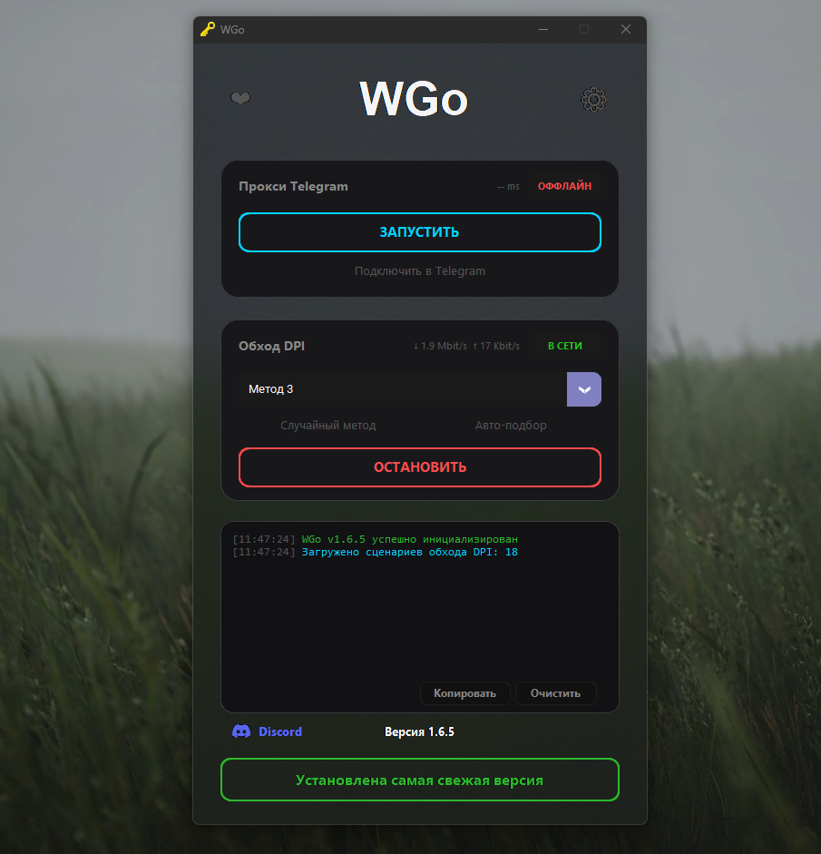

# WGo

**Утилита для обхода сетевых ограничений (DPI) и локального MTProto-проксирования Telegram под Windows**

[Скачать последний релиз](https://github.com/Windows22022/WGo/releases/latest) • [Обратная связь](https://forms.gle/L83YrgySsnyfGUq68) • [Discord-сервер](https://discord.gg/SEv2hWNWet)

  

---

## О проекте

**WGo** объединяет управление обходом DPI (`winws` / `WinDivert`) и локальный **MTProto-прокси** для Telegram в одном окне. Программа избавляет от необходимости править батники вручную — достаточно запустить **Авто-подбор**, чтобы протестировать доступные сценарии и выбрать рабочий вариант под вашего провайдера.

## Основные возможности

| Модуль | Возможности |
| :--- | :--- |
| **Обход DPI** | • **Авто-подбор сценариев** — проверка методов с замером пинга и процента успешных подключений. • **Управление списками** — редактирование доменов, IP-подсетей, исключений и `hosts` из настроек. • **Игровой фильтр (UDP)** — перехват игрового трафика с настройкой диапазона портов. |
| **Прокси Telegram** | • **Локальный MTProto** — работает прямо на вашем ПК без сторонних серверов. • **Подключение в 1 клик** — автоматическая передача адреса, порта и ключа в клиент Telegram. • **Гибкий запуск** — автостарт прокси при открытии Telegram, смена порта и постоянный ключ. |
| **Интерфейс и фон** | • **Работа в трее** — быстрое управление службами и переключение методов из системного трея. • **Персонализация** — выбор темы (Системная, Тёмная, Светлая, Матовое стекло) и акцентного цвета. |
| **Автообновление** | • Фоновая проверка релизов и установка обновлений с сохранением настроек и списков. |

---

## Быстрый старт

1. Перейдите в раздел **[Releases](https://github.com/Windows22022/WGo/releases/latest)** и скачайте архив с актуальной версией.
2. Распакуйте содержимое в отдельную папку (например, `C:\WGo`).
3. Запустите **`WGo.exe`** от имени администратора (необходимо для работы драйвера `WinDivert` и изменения `hosts`).
4. **Для обхода DPI:** нажмите **«Авто-подбор»**, дождитесь выбора метода и нажмите **«ЗАПУСТИТЬ»**.
5. **Для Telegram:** в блоке *«Прокси Telegram»* нажмите **«ЗАПУСТИТЬ»**, затем **«Подключить в Telegram»**.

> **Важно:** Папки `bin` и `lists` должны находиться рядом с `WGo.exe`. Не удаляйте и не перемещайте их.

---

## Частые вопросы (FAQ)

<b>Антивирус или Windows Defender ругается на WGo.exe / WinDivert.sys</b>

 
Это стандартная реакция защитников Windows на программы, использующие драйвер перехвата пакетов <code>WinDivert</code> для работы с сетевым трафиком. Добавьте папку с программой в исключения антивируса и при необходимости распакуйте архив заново.

<b>Программа закрывается сразу после запуска</b>

 
Вероятнее всего, антивирус удалил или заблокировал <code>winws.exe</code> / <code>WinDivert.sys</code> в папке <code>bin</code>, либо не были выданы права администратора (UAC).

<b>Сайты или сервисы перестали открываться при включённом обходе</b>

 
Провайдеры периодически меняют правила фильтрации ТСПУ. Нажмите <b>«Авто-подбор»</b>, чтобы заново найти рабочий метод для вашей сети.

<b>Ошибка «Порт занят» при запуске прокси Telegram</b>

 
Порт <code>1443</code> уже используется другой программой. Откройте <b>Настройки → Прокси MTProto</b> и укажите любой другой свободный порт (например, <code>8443</code> или <code>1080</code>).

---

## Используемые технологии и ресурсы

При разработке WGo использовались следующие открытые инструменты, конфигурации и материалы:

| Проект | Назначение |
| :--- | :--- |
| **[bol-van / zapret](https://github.com/bol-van/zapret)** | Исполняемый модуль `winws` для модификации сетевых пакетов |
| **[Flowseal / zapret-discord-youtube](https://github.com/Flowseal/zapret-discord-youtube)** | Базовые стратегии и списки доменов для обхода DPI |
| **[Flowseal / tg-ws-proxy](https://github.com/Flowseal/tg-ws-proxy)** | Исходная реализация локального проксирования для Telegram |
| **[DanielLavrushin / tspu-docs](https://github.com/DanielLavrushin/tspu-docs)** | Справочная документация по принципам работы ТСПУ |

---

## Команда проекта

- **Windows220_22** — автор и разработчик WGo
- **ZAHSMI** — тестирование и продвижение
- **!🐞»₊°𝙎𝙥𝙞𝙧𝙩🦅** — дизайн иконки (начиная с v1.5.0)
- **Arsen4ic** — дизайн классической иконки (до v1.5.0)
